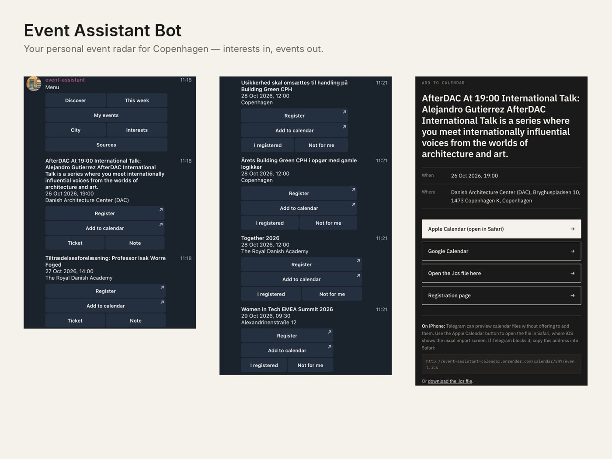
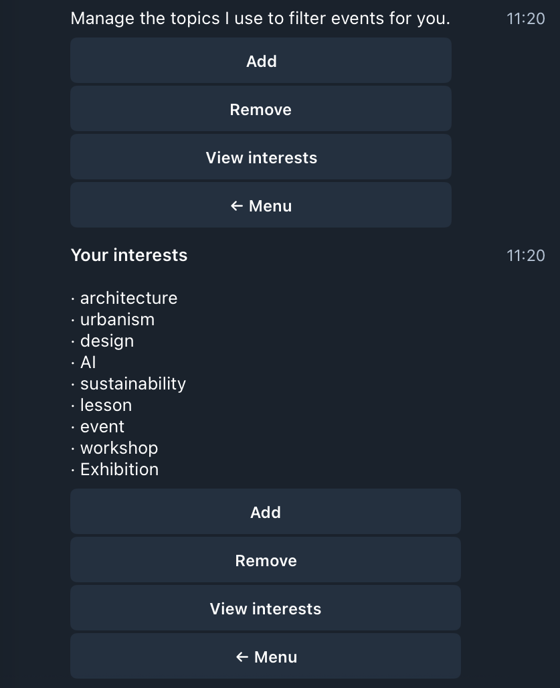
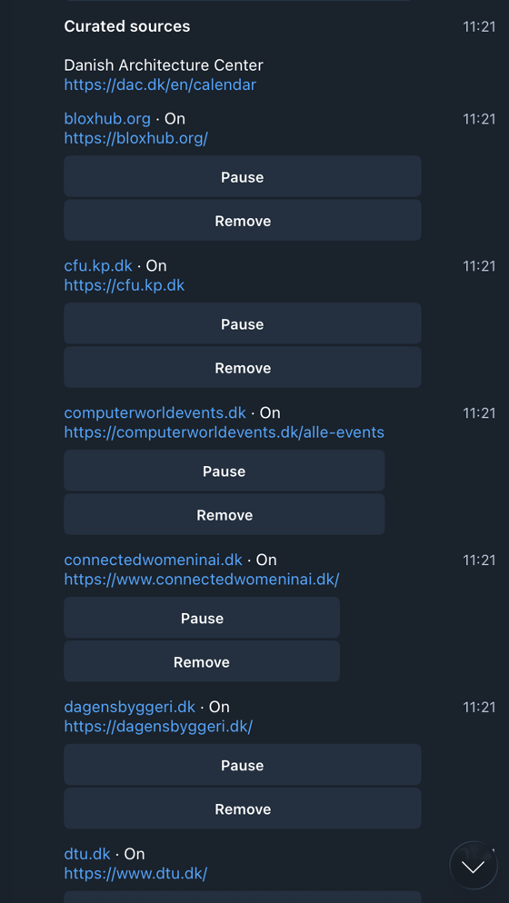
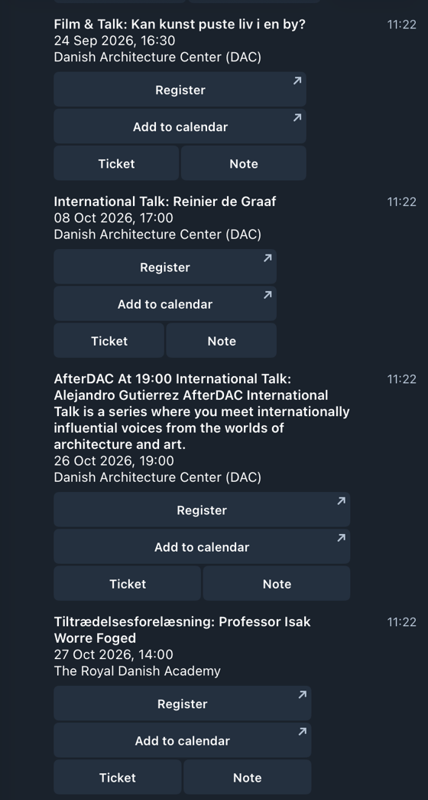
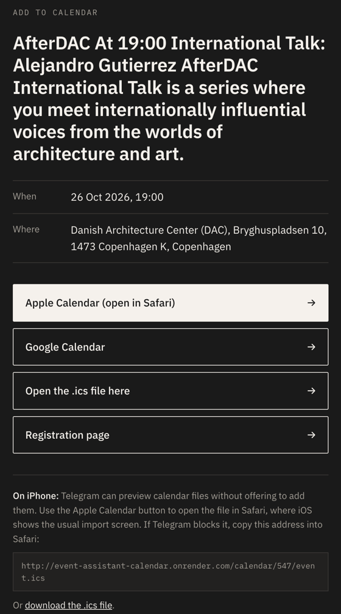
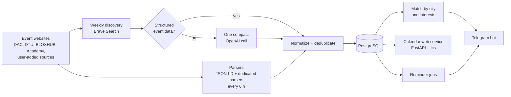

# Event Assistant Bot

**Your personal event radar for Copenhagen.** Set your interests and favourite sources once — the bot watches them for you, sends matching events to Telegram, keeps your registrations and tickets in one place, adds events to your calendar and reminds you before they start.

No more scrolling LinkedIn or checking ten websites so you don't miss a talk, workshop or exhibition.




<p>
  
  
  
</p>

## The problem

Interesting events — talks, PhD defences, workshops, exhibitions — are spread across dozens of university, cultural and community websites. They appear at different times, fill up quickly, and the usual way to find them is to scroll social feeds or check every site by hand. Tickets and confirmations then end up scattered across email and downloads.

## What the bot does

1. **You set your profile** — city, interests (e.g. *architecture, AI, sustainability, workshop*) and the websites you want watched.
2. **It monitors sources on a schedule** — curated Copenhagen sources plus any site you add yourself.
3. **It sends matching events to Telegram** with a direct link to register on the organizer's site.
4. **You keep everything in one place** — mark *I registered*, upload the ticket or QR code, add notes.
5. **It adds events to your calendar** (Google Calendar or Apple Calendar via `.ics`) and **reminds you** before the event.

Registration itself always happens on the organizer's website — the bot never needs access to your email or accounts.

## Features

- Multi-user Telegram profiles with city and interest preferences
- **Discover**, **This week** and **My events** views
- Personal sources: add, enable/disable or remove any event website
- Curated parsers for DAC (Danish Architecture Center), DTU, BLOXHUB, the Royal Danish Academy, CFU, Thoravej 29 and Eventbrite
- Generic Schema.org `Event` (JSON-LD) parser for any event page
- Event deduplication across sources
- *I registered* flow, ticket/QR upload (stored as Telegram `file_id`) and notes
- Add-to-calendar page (Google Calendar link + Apple Calendar `.ics`)
- Scheduled reminders (configurable, default 7 days before)

## Design

A calm, Scandinavian look shared with my product [MØSE](https://møse.dk): warm paper `#F5F1EB`, ink `#1A1A1A`, IBM Plex typography, thin lines and almost no decoration.

- **Messages** use a simple typographic card — bold title, date, place — with short, quiet button labels.
- **Add-to-calendar page** follows the same palette and supports dark mode.
- **Avatar options** are in [`docs/brand`](docs/brand).



## Architecture



| Module | Responsibility |
| --- | --- |
| `app/bot.py` | Telegram handlers and keyboards |
| `app/db.py` | SQLAlchemy models: users, sources, events, registrations, service state |
| `app/sources.py`, `app/*_source.py` | Normalized source interface, JSON-LD parser and dedicated parsers |
| `app/brave_discovery.py` | Weekly search, compact page fetching, JSON-LD extraction, optional OpenAI fallback |
| `app/services.py` | Matching, scheduled scraping, weekly discovery, notifications and reminders |
| `app/calendar_web.py` | FastAPI service for add-to-calendar pages and `.ics` files |
| `app/main.py` | Application startup and job scheduler |

## Cost-aware AI design

The bot uses an LLM only where deterministic code is not enough:

- **Cheap and frequent:** HTML / JSON-LD / dedicated parsers run every `SCRAPE_INTERVAL_HOURS` (default 6 h).
- **Expensive and rare:** web discovery for dynamic or noisy sources (Eventbrite, extra DAC and Academy pages, Thoravej 29) runs at most once every `AI_DISCOVERY_INTERVAL_DAYS` (default 7 days) via Brave Search.
- **Structured data first:** for each candidate page the bot first tries to read Schema.org `Event` JSON-LD locally. If it exists, **no OpenAI call is made**.
- **LLM as a last resort:** only pages without structured data get one compact OpenAI call to structure the already-fetched evidence. The model never browses the web itself.
- **Restart-safe:** the last discovery timestamp is stored in PostgreSQL, so deploys and restarts don't reset the weekly clock.

This keeps routine sources fresh while avoiding the token and search costs of letting a model browse the web several times a day.

## Tech stack

Python 3.12 · python-telegram-bot (job queue) · SQLAlchemy 2 · PostgreSQL · FastAPI · httpx · BeautifulSoup · OpenAI API · Brave Search API · Docker / Docker Compose · Render · pytest · Ruff · GitHub Actions

## Run locally

1. Create a Telegram bot with [BotFather](https://t.me/BotFather) and copy its token.
2. Copy `.env.example` to `.env` and fill in the variables.
3. Start PostgreSQL and the bot:

```bash
docker compose up --build
```

Or run Python directly:

```bash
python -m venv .venv
source .venv/bin/activate
pip install -e ".[dev]"
python -m app.main
```

### Environment

```text
TELEGRAM_BOT_TOKEN
DATABASE_URL
BRAVE_SEARCH_API_KEY        # weekly dynamic-source discovery
OPENAI_API_KEY              # fallback for pages without structured data
OPENAI_DISCOVERY_MODEL=gpt-5.6-luna
SCRAPE_INTERVAL_HOURS=6
AI_DISCOVERY_INTERVAL_DAYS=7
```

## Tests and CI

```bash
pip install -e ".[dev]"
ruff check .
pytest -q
```

Parsers, discovery routing, event display and the calendar service are covered by tests. GitHub Actions runs lint and tests on every push and pull request.

## Deployment

`render.yaml` is a Render blueprint with three parts: a background worker for the bot (Telegram long polling, no public endpoint needed), a small web service for the calendar pages, and a PostgreSQL database. Set `TELEGRAM_BOT_TOKEN`, `BRAVE_SEARCH_API_KEY` and `OPENAI_API_KEY` as secret environment variables in Render.

## Adding a new event source

Prefer stable structured data first (Schema.org `Event` JSON-LD, RSS or an official API). If a site has no structured data, add a dedicated parser class and keep it isolated from the Telegram handlers. Search-based discovery should stay a low-frequency fallback, and the LLM should only structure a small, already-fetched evidence set when deterministic extraction is not enough.

## Roadmap

- Alembic migrations
- Per-user timezone handling
- Several reminder types (7 days / 1 day / morning of the event)
- Parser fixtures for every source and more tests
- Rate limiting

## Author

Built by [Lidiia Moisieieva](https://www.linkedin.com/in/lidiia-moisieieva-3bbb5918a) — architect turned AI systems engineer, building AI tools that work with real-world documents and data.
